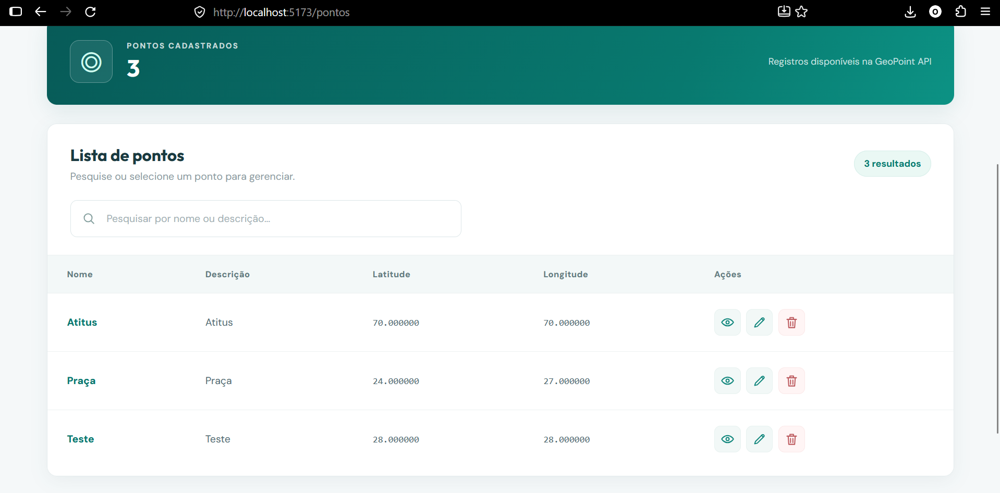
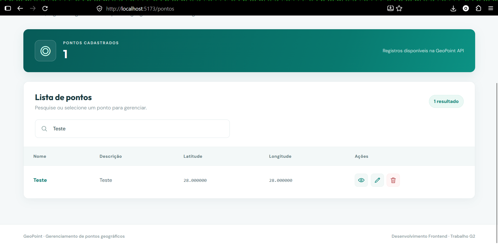
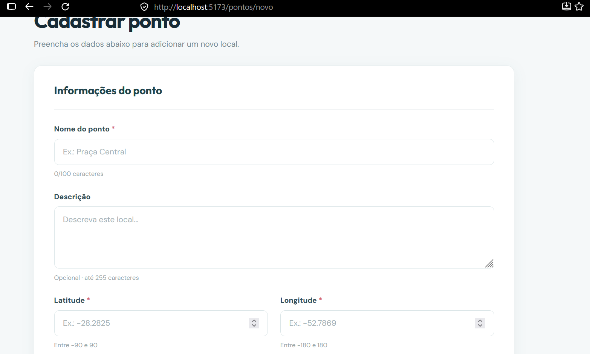
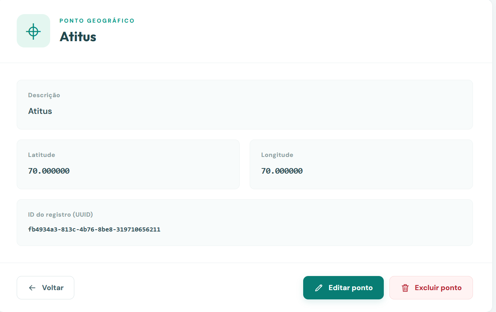
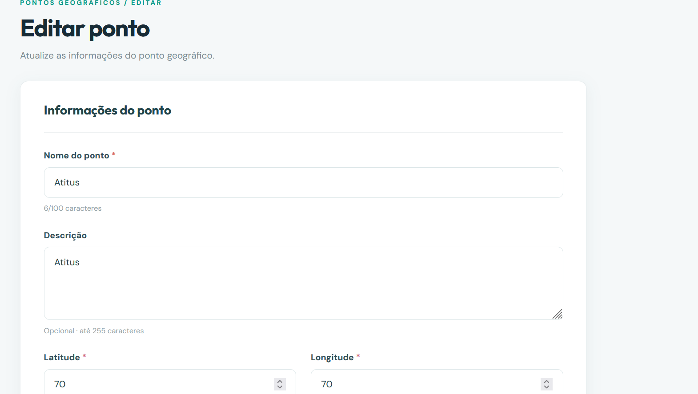

# GeoPoint — Trabalho G2 de Desenvolvimento Frontend

Frontend de CRUD de pontos geográficos criado com **React + Vite + React Router**, integrado à **API Java Spring Boot + PostgreSQL** enviada com o projeto. O código do backend recebido foi preservado em `backend/`.

## Dados da entrega

- **Aluno(s):** Otavio Biazus de Mello - 1139244, Guilherme Luiz Pavan Vial - 1139397
- **Instituição:** Atitus Educação
- **Disciplina:** Desenvolvimento Frontend — Trabalho G2
- **API utilizada em desenvolvimento:** `http://localhost:8080` (servidor Java em `backend/`)

## Pré-requisitos

- Node.js compatível com Vite 7 (20.19+ ou 22.12+) e npm;
- Docker Desktop aberto e funcional para usar o backend Java com PostgreSQL **ou** JDK 21, Maven e PostgreSQL já configurados.

## Como executar — dois terminais

**1. Terminal da API** (na raiz do projeto):

```bash
cd backend
docker compose up --build -d
```

Isso sobe o PostgreSQL e a API Java, iniciando o esquema do banco automaticamente. Aguarde os containers ficarem saudáveis. Teste no navegador **http://localhost:8080/api/points**; a resposta inicial pode ser `[]`.

Para examinar erros de inicialização:

```bash
docker compose logs -f api
```

**2. Terminal do frontend** (na raiz `geopoint-g2`, não em `backend`):

```bash
npm install
```

Crie `.env` a partir de `.env.example` e mantenha:

```env
VITE_API_URL=http://localhost:8080
```

Execute:

```bash
npm run dev
```

Acesse **http://localhost:5173**. Se mudar o `.env`, reinicie o Vite. Pare a API com `cd backend && docker compose down` (sem `-v`, para preservar dados).

**Alternativa sem Docker:** veja `backend/README.md` para iniciar com IntelliJ ou Maven, JDK 21 e PostgreSQL configurado (o projeto disponibilizado exige um banco).

**ATENÇÃO:** a API que está em `backend/` é um servidor **Java/Spring Boot**, não o servidor Node provisório. Portanto **não** use `npm start` dentro de `backend/`.

## Endpoints integrados

| Método | Caminho | Resultado esperado |
|---|---|---|
| GET | `/api/points` | Lista, ou `[]` quando vazia |
| GET | `/api/points/{id}` | Objeto com UUID e dados do ponto |
| POST | `/api/points` | Cria e retorna 201 |
| PUT | `/api/points/{id}` | Atualiza e retorna 200 |
| DELETE | `/api/points/{id}` | Exclui e retorna 204 sem corpo |

Payload JSON para POST/PUT:

```json
{
  "name": "Praça Central",
  "description": "Praça principal da cidade",
  "latitude": -28.2825,
  "longitude": -52.7869
}
```

## Rotas do frontend

| Rota | Tela |
|---|---|
| `/pontos` | Tabela, filtro local e exclusão |
| `/pontos/novo` | Cadastro |
| `/pontos/:id` | Detalhe |
| `/pontos/:id/editar` | Edição |
| `*` | Página não encontrada |

## Estrutura do projeto

```text
geopoint-g2/
  backend/              # API Java 21 + Spring Boot + PostgreSQL enviada
    src/main/...
    pom.xml
    Dockerfile
    docker-compose.yml
  src/
    components/         # Navbar, tabela, filtro, formulário, campos, botões
    pages/              # Lista, cadastro/edição, detalhe, não encontrado
    services/api.js     # fetch com tratamento de erros do backend Spring
    utils/validacao.js  # validações e preparação do payload
    styles/global.css   # CSS responsivo
    App.jsx             # rotas
    main.jsx            # BrowserRouter
  .env.example
  package.json
```

## Critérios implementados

- CRUD real consumindo `fetch` da API Java, sem registros estáticos;
- Filtragem local, sem diferenciar caixa, por nome ou descrição;
- Componentes reutilizáveis e formulário único para cadastrar/editar;
- Estado de carregamento, lista vazia, erro de conexão, tratamento de 400/404 e erros por campo do backend;
- Confirmação de exclusão, estado atualizado sem recarregar a página e botão salvar desabilitado durante a requisição;
- CSS responsivo e tabela com rolagem interna em telas estreitas.

## Prints para entregar (obrigatórios).

- Tabela com pontos;

- Campo de busca filtrando;

- Formulário de cadastro;

- Tela de detalhe;

- Formulário com dados existentes.


